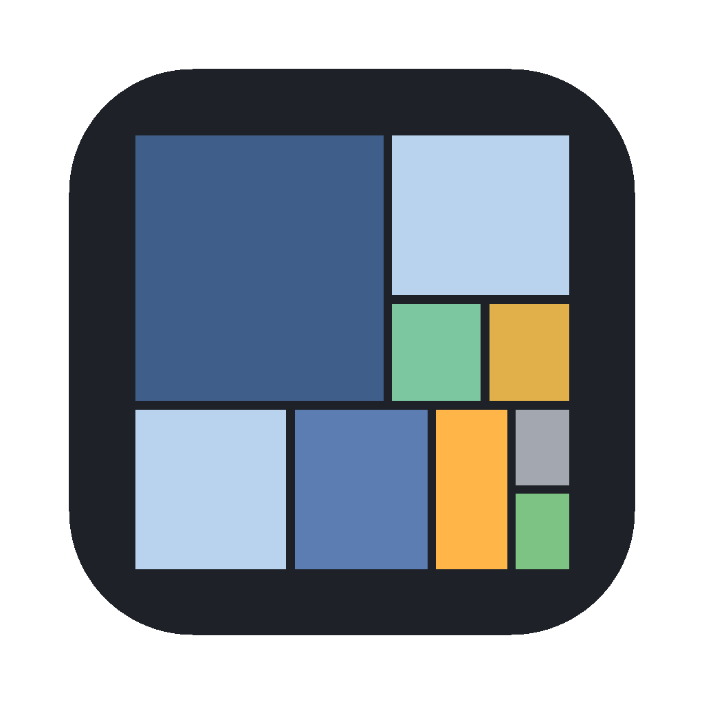

# Tessera

Tessera показывает, чем занят диск на MacOS. Содержимое папки рисуется как карта из
прямоугольников: чем больше файл или папка, тем больше прямоугольник. Крупные файлы
видно сразу, искать их по списку не нужно.



## Установка

1. Скачайте `Tessera-<версия>.dmg` со страницы [Releases](../../releases).
2. Откройте DMG и перетащите Tessera в «Программы».
3. При первом запуске нажмите на Tessera правой кнопкой и выберите «Открыть».
   Приложение не подписано сертификатом Apple, поэтому обычный двойной клик macOS
   в первый раз заблокирует.

Нужна macOS 13 или новее. Работает на Apple silicon и Intel.

Чтобы Tessera видела весь диск, дайте ей полный доступ: Системные настройки →
Конфиденциальность и безопасность → Полный доступ к диску → добавьте Tessera.
Без этого системные и чужие папки останутся на карте «неизвестным» местом.

## Возможности

- Карта строится по ходу сканирования, ждать конца не обязательно.
- Двойной клик по папке открывает её крупнее, ⌫ возвращает назад.
  ⌘− и ⌘+ меняют, сколько уровней вложенности видно сразу.
- Показывает свободное место на диске и место, которое занято, но не видно
  (например, снимки APFS или папки без доступа).
- Если файлы меняются во время работы, карта обновляется сама.
- Фильтры: `*.jpg` покажет только картинки, `>100mb` только большие файлы,
  `>1year` то, что давно не меняли. Условия можно сочетать через `;`.
  Подробности в меню Help › Filtering.
- Цветные метки (клавиши 1–4), чтобы отмечать то, что потом удалить или перенести.
- Контекстное меню: открыть, показать в Finder, просмотр по пробелу,
  скопировать путь, переместить в Корзину.
- Результаты сканирования можно сохранить в файл и открыть позже.
  Есть экспорт списка файлов в CSV и текст.
- Интерфейс на русском и английском.

## Командная строка

Сканирование можно запустить без интерфейса, например, чтобы найти большие образы
в «Загрузках» и сохранить список в CSV:

```bash
/Applications/Tessera.app/Contents/MacOS/Tessera scan ~/Downloads filter "*.dmg;>100mb" \
    export "Files as CSV" ~/big-dmgs.csv autoclose
```

## Сборка из исходников

Нужны Xcode 15 или Command Line Tools (`xcode-select --install`).

```bash
swift test                  # тесты
bash scripts/build-app.sh   # собирает build/Tessera.app
bash scripts/make-dmg.sh    # собирает build/Tessera-<версия>.dmg
```
